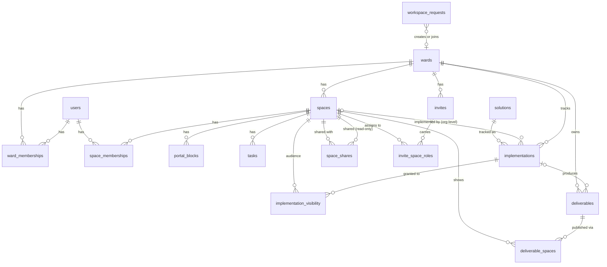

# WardForward — Data Model

The runnable DDL is in [`db/schema.sql`](db/schema.sql); this file is the rationale, the
diagram, and the audit trail of how the open design questions were resolved. Everything here
derives from [`BLUEPRINT.md`](BLUEPRINT.md).

> Reviewed: drafted by Opus 4.8, audited by Fable 5 (July 2026), resolutions confirmed by the
> owner. The "Resolved questions" section below records what changed and why.

## Conventions

- **IDs**: app-generated `TEXT` (ULID/UUID). Portable across environments; no reliance on
  autoincrement.
- **Timestamps**: `TEXT` ISO-8601 UTC (`datetime('now')`).
- **Booleans**: `INTEGER` 0/1. **Enums**: `TEXT` + `CHECK`.
- **Tenancy**: every ward-scoped table carries `ward_id` (row-level multi-tenancy — one DB,
  filter by `ward_id`). Only `users` and `solutions` are global. Child tables denormalize
  `ward_id` so every tenant query filters on a local column without a join.
- **Foreign keys**: D1 **enforces** FK constraints by default (equivalent to
  `PRAGMA foreign_keys = on`; cannot be disabled, only deferred per-transaction via
  `PRAGMA defer_foreign_keys`). Tables are declared in dependency order; migrations that
  need to reshape tables can defer within their transaction.

## Entity diagram

## Tables at a glance

| Table | Purpose |
|---|---|
| `users` | Google-identified people; may belong to multiple wards |
| `solutions` | Global catalog **and** the submission pipeline (one table, keyed by `status`) |
| `workspace_requests` | Request→approve gate: `create` a new ward (operator reviews) or `join` an existing one after unit-number dedupe (that ward's superadmins review) |
| `wards` | The tenant; `unit_number` dedupes; `prefix` = the ward's zippa.run prefix (e.g. `m44`) |
| `ward_memberships` | user↔ward + ward role (`superadmin`/`member`) |
| `spaces` | An audience (Public/Bishopric/Ward Council/org); the app-wide visibility primitive; also the portal (1:1); `archived` hides unused defaults; `share_url` = the portal's pasted short link |
| `space_memberships` | user↔space + space role (`owner`/`member`) |
| `space_shares` | Whole-space read-only sharing: members of another space may view this space's portal + contents |
| `portal_blocks` | Rich-text blocks on a portal |
| `tasks` | Lightweight self-archiving task list per space (optional assignee) |
| `implementations` | A ward's record of working a solution; `visibility` = `ward` or `restricted` |
| `implementation_visibility` | Multi-valued audience grants for `restricted` tracker entries |
| `deliverables` | The output (url/file/image); tied to an implementation or ad-hoc; 1 implementation : N deliverables; `short_url` = optional pasted short link |
| `deliverable_spaces` | Publishing layer: which spaces show a deliverable + portal inclusion/order |
| `invites` / `invite_space_roles` | Callings-chart invites → materialize into memberships |
| `portal_sections` | Named sections on a space's portal ("Ward Links", "Interviews"); `deliverable_spaces.section_id` places a card in one |
| `service_*`, `request_tokens`, `invite_*`, `vol_warn_sent` | Service opportunities and requests — see "Service opportunities, requests and invitations" below |

## Key design decisions

1. **Row-level tenancy, one database.** No per-ward DBs. `ward_id` everywhere ward-scoped.
2. **Spaces are the single visibility primitive.** Deliverable visibility = which spaces it's
   published into (`deliverable_spaces`). Tracker visibility = `implementations.visibility`
   (`ward` = all ward members) plus multi-valued grants (`implementation_visibility`) for
   `restricted` entries. Whole-space read-only sharing = `space_shares` (e.g. Activities
   Committee shares its portal with Ward Council and Bishopric). No parallel permission systems;
   shares and grants only ever *widen* from fail-closed defaults, and neither chains
   transitively.
3. **Ownership vs. visibility split.** `created_by_user_id` on deliverables/tasks encodes the
   "only the creator edits/deletes" rule (app-enforced); space membership encodes visibility.
4. **Implementations are ward-scoped with an optional implementing space.** `space_id` NULL =
   ward-level (`ward_singleton` solutions: Exec Sec, Ward Clerk, Bishopric categories); set =
   that org's own copy (`per_space` solutions). Uniqueness via two partial indexes. Catalog
   *category* is shelving only — audience always comes from spaces.
5. **Deliverables have a separate publishing layer** (`deliverable_spaces`) so one artifact can
   appear in several portals with independent include/order.
6. **Short links are pasted, not owned** *(changed 2026-10)*. Short links live on zippa.run (a
   separate project with no API); a leader makes one there and pastes it into
   `deliverables.short_url` or `spaces.share_url` — a plain http(s) URL column, the only place
   the relationship is recorded. QR codes are **derived** (SVG at render), never stored: the
   short link when set, else the destination. *(Replaces the go4-era `short_links` table + KV
   mirror, dropped before any deploy.)*
7. **Invites carry future memberships.** People added via the callings chart don't exist as
   `users` until they log in with Google, so `invites` (+ `invite_space_roles`) hold the intended
   ward/space roles and materialize on acceptance.
8. **Stateless sessions.** Signed cookie, short TTL, no sessions table. Authorization is
   re-checked against D1 per request, so a stale cookie only affects identity, never roles.

## Resolved questions (audit trail)

**#1 — Implementation scope → ward-scoped, nullable `space_id`.** Space-scoping forced every
Exec-Sec/Ward-Clerk solution to name an "owning space" that doesn't exist. Now: NULL = ward-level,
set = org-level (`per_space`). Enforced by partial unique indexes `ux_impl_ward` / `ux_impl_space`.

**#2 — Category→space mapping → dissolved.** With #1, no mapping is needed. Category is catalog
shelving; audiences come from spaces.

**#3 — Tasks → confirmed.** Per-space grain (spaces:portals are 1:1), optional `assignee_user_id`.

**#4 — Tracker visibility → per-entry, multi-valued.** Owner ruling (two rounds): NOT blanket
ward-wide — some Bishopric implementations must be Bishopric-only, others visible to Ward Council
or everyone — and a single visibility space is not enough (an entry may be shared with several
audiences at once). Model: `implementations.visibility` (`ward` | `restricted`, fail-closed
default `restricted`) + `implementation_visibility` grant rows. A `restricted` entry is visible to
its owner, its implementing space (members + `space_shares` viewers), and each granted space's
direct members. Deleting a grant/share only narrows visibility, so CASCADE deletes are safe
(the earlier single-column RESTRICT rationale no longer applies). App defaults: `per_space` →
`restricted`; `ward_singleton` → `ward`; owner can change.

**Owner addition — whole-space sharing (`space_shares`).** A space's owners can share the space
read-only with other spaces (Activities Committee → Ward Council, Bishopric). Viewers see the
portal + its contents but edit nothing. Not transitive; does not chain through grants.

**Owner addition — new categories/default spaces:** Activities Committee and Ward Mission join
the catalog category enum and the default space set.

**#5 — Sessions → stateless** (decision 8). Revisit only if "log out everywhere" is needed.

**#6 — D1 FK enforcement → corrected.** The draft claimed D1 doesn't reliably enforce FKs; per
current Cloudflare docs it **enforces them always** (only per-transaction deferral exists). The
`NOT NULL + ON DELETE SET NULL` contradiction on `deliverables.created_by_user_id` (which would
have made user deletion throw) is fixed to `ON DELETE RESTRICT`.

**#7 — Deliverables per implementation → 1:N confirmed** (e.g. URL + printable PDF from one
solution).

**Audit additions:** `spaces.archived` (blueprint §6 "hide" was unrepresentable);
`workspace_requests.kind` `create`/`join` + `target_ward_id` (blueprint §9 "request to join" was
unrepresentable); dropped `spaces.is_public` (duplicated `kind='public'`), dropped
`spaces.portal_short_link_id` and `deliverables.short_link_id` (bidirectional duplication +
circular FK; `short_links.target_*` is the single direction). *(2026-10: `short_links` itself
was later dropped; the pasted `short_url` / `share_url` columns hold a URL, not a reference,
so that concern doesn't apply.)*

## App-layer rules the schema can't express (enforce in code)

- Only the creator edits/deletes their deliverables/tasks — **except a ward superadmin**, who
  can edit/delete anything in their ward (break-glass).
- Visibility resolution (the canonical check — implement once, in one place):
  - `canViewSpaceContent(u, s)` = member of `s`, OR `s.kind='public'`, OR member of any space
    `s` is shared with via `space_shares`, OR **a superadmin of `s`'s ward (break-glass)**.
  - `canViewImplementation(u, i)` = **superadmin of `i.ward_id` (break-glass)**, OR if
    `i.visibility='ward'` → any member of `i.ward_id`; else → `u` is `i.owner_user_id`, OR
    (`i.space_id` set AND `canViewSpaceContent(u, i.space_id)`), OR direct member of any space
    granted in `implementation_visibility`.
  - No transitive chaining: shares don't extend grants; shares of shares grant nothing.
  - **Ward superadmin = break-glass:** can view AND manage everything within their ward
    (including org spaces they don't belong to). Scope is limited to what WardForward stores — it
    does NOT grant access to a link's destination (e.g. a Google Doc keeps its own permissions).
    A ward must always keep ≥1 superadmin; superadmins can grant/revoke the role to other members.
- Only space owners (or a ward superadmin) manage that space's `space_shares` and portal content.
- `implementation_scope` ⇒ `space_id` NULL-ness; `per_space` must reference an `org`-kind space.
- `workspace_requests`: `ward_name` required when `kind='create'`; `target_ward_id` when `'join'`.
- Re-invites UPDATE the existing `invites` row (UNIQUE(ward_id, email)).
- On login, refresh `users.email`/`name` from Google claims keyed on `google_sub`.
- Pasted links (`deliverables.url`, `short_url`, `spaces.share_url`): http(s) only, normalized
  on write and guarded on render (`src/lib/urls.ts`).

## Volunteer sign-ups

Spec: `docs/superpowers/specs/2026-11-21-volunteer-signups-design.md`. Organization presidents
post needs; ward members sign up from an unguessable public link with any email. All tables
carry `ward_id`; every query filters on it. `wards.timezone` (IANA, default `America/Denver`)
drives cutoffs, "the day before", "within 14 days" and "is over". Dates (`YYYY-MM-DD`) and
times (`HH:MM`) are ward-local wall time.

| Table | Holds |
|---|---|
| `vol_posts` | A post for one org space: title, public note, private details, cancel cutoff (hours before the role's start, 0–336, default 24), random `public_id` for `/v/<public_id>`, `full_notified_at` |
| `vol_dates` | One or more dates per post (optional start time); `approval_nudged_at` for the 48h nudge |
| `vol_roles` | Helper roles per date: name, number needed (1–500), optional times, note, "what are you bringing?" prompt |
| `volunteers` | Email-only people, unique per `(ward_id, email)`; `approval`; `discord_user_id` once connected |
| `vol_signups` | A volunteer on a role: `status`, `over_limit`, `bringing`, `confirmed_at`, `confirm_seq` (order of confirmation on the role, set atomically; decides who is over the limit), `ended_at`, `reminded_at`. Partial unique index: one `waiting`/`confirmed` row per `(role_id, volunteer_id)` |
| `vol_editors` | "Who can manage volunteer posts" for an org space, beyond its owners |
| `vol_tokens` | Single-use email-confirmation tokens (SHA-256 hash only; 72h) |
| `vol_rate_events` | Rate-limit events for the public forms; pruned by the hourly cron |

`volunteers.approval`: `none` (address not verified yet) · `pending` (verified, waiting for a
leader) · `approved` (once, for the whole ward) · `declined` (can't sign up again; Bishopric can
undo). An email that belongs to a WardForward member of the ward is approved automatically.

`vol_signups.status`: `waiting` (never counts or holds a spot) · `confirmed` · `cancelled` (by the
volunteer) · `withdrawn` (an over-the-limit offer withdrawn) · `removed` (by a leader, or the
volunteer's approval was revoked) · `declined` · `lapsed` (still waiting when the date was over).
A role is full when its `confirmed` count ≥ `needed`; over-filling only happens through a late
approval or a race, and those sign-ups get `over_limit = 1`.

Who may see and do what (`src/lib/volAccess.ts`, fail closed; `space_shares` grant nothing here):

| Who | How WardForward knows | Can |
|---|---|---|
| Post creator | `vol_posts.created_by_user_id` | Edit their post, approve first-time volunteers on it |
| Organization's volunteer editors | owners of the `org` space, plus `vol_editors` rows | Create, edit and delete that organization's posts; approve first-time volunteers on them |
| Organization's other leaders | member (not owner) of the `org` space | See that organization's posts, with names and private details, read-only |
| Ward council | member of the `ward_council` space | See every post and every sign-up, read-only |
| Bishopric | member of the `bishopric` space | Create for any organization, edit, delete and approve anything; undo declines, revoke approvals |
| Ward superadmin | `ward_memberships.role='superadmin'` | Same as Bishopric (break-glass) |
| Volunteer | email, verified by link; `wardforward_vol` cookie | Sign up, see and cancel their own sign-ups; private details and other volunteers' names only while approved and the post isn't over |
| Anyone with the link | nothing | The public page: counts and what's being brought, never names, emails or private details |

Deliberate privacy choice (Sam, 2026-11-21): on a post's manage page, read-only viewers (the
organization's other members, the Ward Council) see volunteers' **names only**. Their **email
addresses** are shown only to those who can edit the post and approve volunteers (they check
people against the directory).

## Service opportunities, requests and invitations

Spec: `docs/superpowers/specs/2026-11-22-service-opportunities-requests-design.md`. All tables
carry `ward_id` (except `invite_category_delegations`, scoped through its invite) and every query
filters on it. Permission decisions: `src/lib/serviceAccess.ts` (categories, delegates, requests)
and `src/lib/volAccess.ts` (posts), both fail closed. An existing local database is upgraded with
`db/upgrade-2026-11-22-service.sql`.

| Table / column | Holds | Who sees it |
|---|---|---|
| `service_categories` | Per-ward list, kind `opportunity` or `request`: slug, name, icon key, `default_audiences`, `council_may_create`, `confidential`, `opportunity_category_id` (request → where "Turn into a service opportunity" starts), `discord_webhook_url` (a secret: never shown in full after saving, never logged), position, archived. New wards get 11 defaults (`ensureServiceCategories`, also run lazily) | Names and icons are public (serve/help pages); settings: the category's managers |
| `service_category_spaces` | A category's owning spaces (`org`, `bishopric` or `ward_council`; app-enforced) | — |
| `service_delegates` | Coordinators named by a category's managers. Count only while they still have a `ward_memberships` row | Managers |
| `service_warn_prefs` / `service_warn_others` | Each manager's own fill-warning choice per category: warn me, hours before (1–336, default 48), others to warn | That manager |
| `vol_warn_sent` | One row per (post date, recipient) once a fill warning went | — |
| `vol_posts.category_id` / `.audiences` | Every post's category (nullable only for the upgrade backfill; always set by the app) and who it's for (`brothers,sisters,youth,children`) | As the post |
| `vol_signups.child_name` | `''` = the volunteer; else a child's first name (a parent signs up their child). The active unique index is per (role, volunteer, child name, case-insensitive) | As the sign-up |
| `service_requests` | A member's request: name, email, optional phone, note (≤200), moving in/out + preferred date, Christmas own/other family, status (`unverified`, `new`, `in_progress`, `done`, `declined`), assignee (one of the category's delegates), private note (≤200). Deleted 30 days after it's closed; unverified ones after 7 days | `canSeeRequest`: the category's managers and delegates; a **confidential** category only its owning spaces' owners (the bishop, for the bishopric space), its delegates and superadmins — not other bishopric members. Never on a public page; leader emails never carry the details |
| `request_tokens` | Single-use 48h verification tokens for requests (SHA-256 only) | — |
| `invite_batches` | One paste of invitation addresses for a post: who, when, post (+ title), note, counts, status (`sending`, `waiting_cap`, `done`, `cancelled`) | The operator (all wards); the leader who sent it (progress) |
| `invite_recipients` | The pasted addresses, claimed atomically by the pump; deleted when the batch ends | — |
| `invite_suppressions` | "Stop service invitations from <ward>": SHA-256 of the normalized address only. Blocks invitations, never notify mail | — |
| `invite_daily_counts` | Invitations sent per ward-local day, against `wards.invite_daily_cap` (default 5000; the operator edits it) | Operator |
| `invite_category_delegations` | Category delegations carried by an invite; accepting it adds the delegate rows | — |
| `wards.serve_short_url` / `help_short_url` / `serve_section_on` / `help_section_on` | Portal service sections: pasted short links (http(s) only) and on/off (superadmin) | Public via the portal |
| `workspace_requests.bishop_approved` | The required "Our bishop has approved using WardForward for our ward" box (Handbook 38.8.21.2) | Operator |

Category roles (spec §3): *managers* = owners of an owning space, bishopric members and
superadmins (confidential: owners of an owning space and superadmins only). *May create* in an
opportunity category: its delegates; or, while it has none, its managers and the owning orgs'
`vol_editors`; plus ward council members when `council_may_create`; plus bishopric and
superadmins. Messages about a category go to its delegates, else as before (posts: creator +
org editors; requests: owners of the owning spaces, else superadmins); a post's creator always.

## Not modeled yet (deferred, by design)

- **Callings default template** as a reference table — `calling_title` is free text, with the
  standard LDS org set shipped as seed data.
- **Audit log** of who-changed-what — `created_by`/timestamps only for now.
- **Click analytics** on short links (zippa.run's concern now), **email/notification** records beyond `invites`,
  **per-ward theming** of portals.
